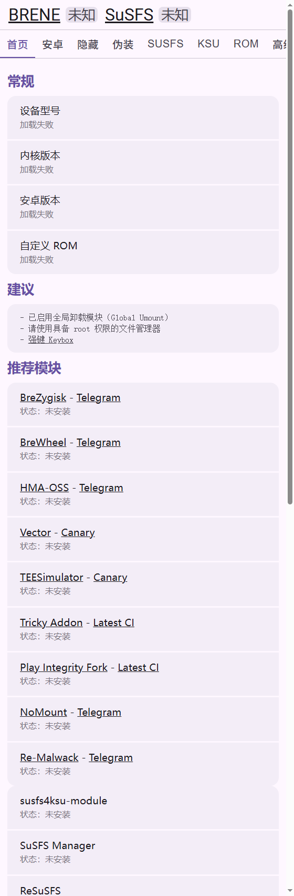

# BRENE 中文化（SuSFS WebUI 汉化 fork）

上游：[rrr333nnn333/BRENE](https://github.com/rrr333nnn333/BRENE)（KernelSU 模块，**AGPL-3.0**）
本 fork：[lvdao222/BRENE](https://github.com/lvdao222/BRENE)，当前基线 **v0.0.74**（tag `503da574`）。

这个仓库存的是**汉化后的 BRENE 模块**：在原版 WebUI 上加了一层 i18n，并新增「设置 → 界面语言」切换（English / 简体中文，默认跟随系统语言，选择保存在本机 `localStorage`）。



## 目录

```
module/            汉化后的模块本体（模块 zip 的内容就来自这里）
  webroot/         汉化后的 WebUI
    i18n.js        词条字典 + t() + applyTranslations() + 语言切换
    index.html     原版结构 + data-i18n 标记 + 「设置」页签
    script.js      原版逻辑 + 动态文案走 t() + 切语言重绘
    styles.css     原版样式 + .lang-switch 样式
upstream/webroot/  上游 v0.0.74 的 webroot **原文**（只做三方合并的基线，别改）
tools/             检查 + 同步 + 打包脚本
dist/              打包产物（不进版本库）
```

## 每次上游更新怎么做

```bash
python tools/sync-upstream.py BRENE-v0.0.75.zip   # 自动三方合并，保留汉化
node tools/check-i18n.mjs                          # 词条一致性
python tools/check-html.py                         # 有没有漏翻的可见文本
python tools/pack.py                               # 产出 dist/BRENE-v0.0.75-zh.zip
```

`sync-upstream.py` 会：把 sh/prop/tools 换成上游新版；`webroot/` 里改过的文件用 `git merge-file` 做 ours/base/theirs 三方合并（我们的 `data-i18n`、`t()` 保留，上游新增的行进来）；更新 `upstream/` 基线；最后跑检查给你待翻译清单。合并冲突会明确列出来。

翻译规范（给 AI 或人手都适用）：

- 静态文案 → 在元素上加 `data-i18n="group.key"`；text-field 的 label / placeholder 用 `data-i18n-label` / `data-i18n-placeholder`。
- 动态文案（JS 里写进 DOM 的）→ `t('group.key')`，参数用 `{name}` 占位。
- `i18n.js` 里 `en` 保留上游英文原文，`zh` 写中文；两边 key 必须一一对应。
- 品牌名 / 模块名 / 文件路径不翻（清单见 `tools/allow-untranslated.txt`）。
- 动态文本要存「状态」而不是存成已翻译字符串，否则切语言不会重绘（见 `script.js` 里的 `renderers` / `rerenderAll`）。

## 打包/安装

`python tools/pack.py` 产出 `dist/BRENE-<版本>-zh.zip`，结构和官方 release 一致（zip 根目录就是 `module/` 内容），直接当普通 KernelSU 模块刷入即可。

## 许可

上游是 AGPL-3.0。本仓库是它的修改版，**同样以 AGPL-3.0 发布**，保留上游 `LICENSE` 与原作者署名（`module.prop` 的 `author` 行不动）。分发本仓库产物时，请一并提供本仓库源码链接。想提 PR 给上游也可以：i18n 层是独立文件 + 标记属性，不改变原有行为，默认语言跟随系统，英文用户无感。
